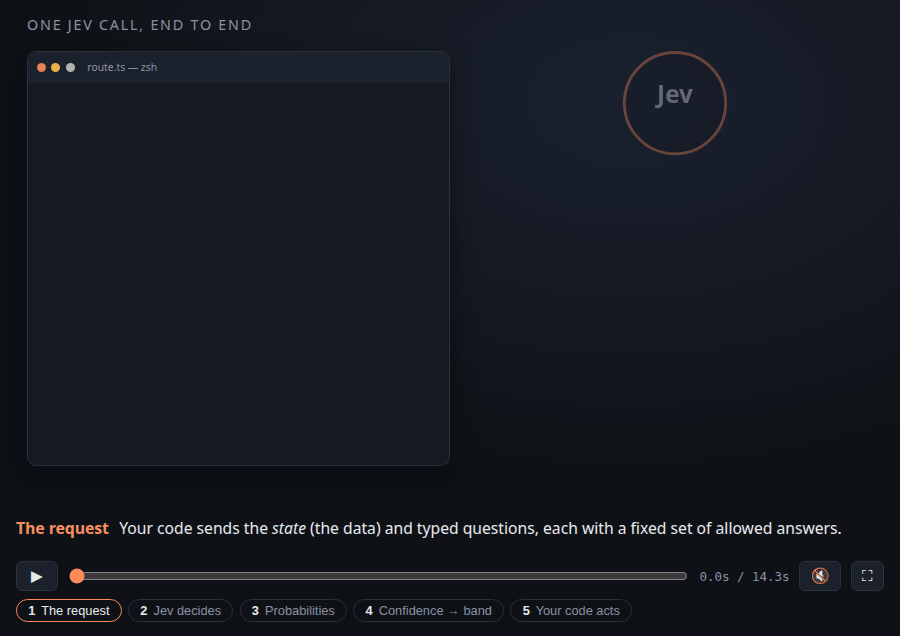

# Skills

Agent skills for [Claude Code](https://claude.com/claude-code) and other agents that support `SKILL.md`.

## `lesson-panel`

Four agents that review one lesson of a course made with `learn`. The author writes the lesson. An expert checks that it is true, a novice checks that a newcomer can learn it, and a course-flow reviewer checks that it belongs in the course. Notes go back to the author until all three approve.

```bash
npx skills add jpmmatias/skills --skill lesson-panel -g -a claude-code
```

In a course folder, ask to continue with the lesson panel. The roles live in `skills/lesson-panel/agents/`.

## `learn`

A skill that teaches a concept from first principles. It explains *why* things work, builds intuitive mental models, gives small annotated reference examples, and makes hidden mechanisms visible with diagrams and narrated motion scenes.



<sub>A motion scene from a course made with <code>learn</code>: one <a href="https://docs.typesafe.ai">Jev</a> API call, end to end. In the lesson it's narrated, scrubbable and split into chapters.</sub>

**New here? Read the [step-by-step guide with screenshots](docs/GUIDE.md).** It has a path for non-technical learners and one for developers.

It has two modes:

- **Explain mode** answers a one-off "how does X actually work?" in the terminal. You get the core idea, an ASCII diagram, a small annotated example and verified links to go deeper. No files are created.
- **Course mode** (`/learn <topic>`) turns the current directory into a learning workspace that spans several sessions.

### What a course includes

| Piece | What it does |
|---|---|
| `MISSION.md` | Why you're learning this. Every lesson ties back to it. |
| `lessons/*.html` | Short, beautiful, self-contained lessons with citations and a recommended primary source |
| `reference/*.html` | Printable cheat sheets and glossaries |
| `index.html` | Dashboard with the mission, milestone map, mastery per lesson and spaced-review reminders |
| `RESOURCES.md` | Curated, verified articles, docs, videos and playgrounds |
| `learning-records/` | What you've actually shown you can do, used to choose the next lesson |

### Built on learning research

- **Retrieval practice, spacing and interleaving** for long-term retention, not just a feeling of fluency.
- **Mayer's multimedia principles**: every core idea gets a diagram (dual coding), with labels on the diagram, no decoration, one highlight colour, step-by-step reveals, and narration instead of repeated on-screen text.
- **No "learning styles"**: matching lessons to a learning style has no empirical support ([Pashler et al., 2008](https://journals.sagepub.com/doi/full/10.1111/j.1539-6053.2009.01038.x)), so visuals are designed to help everyone.
- **Animations only when the motion is the concept** ([Höffler & Leutner, 2007](https://eric.ed.gov/?id=EJ780451)). You control playback, and reduced-motion settings are respected.
- **Light gamification** ([Sailer & Homner, 2020](https://eric.ed.gov/?id=EJ1245270)): XP only for first-try correct answers, mastery over points, spaced review instead of login streaks, and milestones that unlock only after the agent reviews real work.

### Starter kit

`skills/learn/starter/assets/` is copied into every new course. Everything is dependency-free HTML, CSS and JS that opens straight from disk:

- `style.css`: a print-friendly stylesheet with tokens for light and dark mode
- `theme.css`: the course's look (colours, fonts, headings, corners, scene palette), swappable without touching any lesson
- `quiz.js`: immediate-feedback quizzes with shuffled options
- `diagram.js`: step-through diagrams, confidence bands, animated probability bars, a threshold explorer, visual recall drills and faded worked examples
- `progress.js` + `course.js`: the dashboard, the progress header and evidence-gated milestones
- `scene.js`: a narrated, scrubbable motion-scene player in explainer-video style (terminal with syntax highlighting, concentric layers, node-and-box flows)

`skills/learn/starter/tools/check.mjs` is a headless workspace check. It catches JS errors, broken links, phone-width overflow, missing practice or challenges, and screenshots every figure and scene so the agent can look before shipping. It needs `npm install --prefix skills/learn/starter/tools` once.

`skills/learn/starter/examples/scenes-0001-sampling.js` is a complete worked motion scene to copy from. The skill decides per lesson whether a scene is worth building: yes for processes over time and hidden mechanisms, no for static structures or concepts better learned by changing a variable.

## Install

### With [skills.sh](https://skills.sh) (recommended)

```bash
npx skills add jpmmatias/skills --skill learn -g -a claude-code
```

- `--skill learn` picks the skill from this repo. Run `npx skills add jpmmatias/skills --list` to see what's available.
- `-g` installs it for your user, so every project can use it. Leave it out to install into the current project only.
- `-a claude-code` targets Claude Code. Leave it out to choose agents interactively, or use `-a '*'` for every supported agent.

Keep it up to date, or remove it:

```bash
npx skills update learn -g
npx skills remove learn -g
npx skills list
```

The CLI sends anonymous install telemetry to skills.sh. Set `DISABLE_TELEMETRY=1` to opt out.

### As a Claude Code plugin

This repo is also a Claude Code plugin marketplace. Inside Claude Code:

```
/plugin marketplace add jpmmatias/skills
/plugin install learn@jpmmatias
```

Or from your shell:

```bash
claude plugin marketplace add jpmmatias/skills
claude plugin install learn@jpmmatias
```

Plugin skills are namespaced, so the command becomes `/learn:learn <topic>`. Updates arrive through `/plugin`. To uninstall, run `claude plugin uninstall learn@jpmmatias`.

### Manually

```bash
git clone https://github.com/jpmmatias/skills.git
cp -r skills/skills/learn ~/.claude/skills/learn
```

### For development (symlink)

If you want to edit the skill, link your clone instead of copying it. Changes take effect in the next session, and `git pull` updates it:

```bash
git clone https://github.com/jpmmatias/skills.git ~/code/skills
ln -s ~/code/skills/skills/learn ~/.claude/skills/learn
```

Pick one method. Two installs of the same skill (for example the plugin and a copy in `~/.claude/skills/`) show up as two separate skills.

### Use it

Restart Claude Code (or start a new session), then follow the [guide](docs/GUIDE.md). In short:

- **Start a course:** make an empty folder, `cd` into it, and run `/learn <topic>`. The skill first asks why you're learning, what you already know and what your setup is, then builds the workspace and the first lesson.
- **Continue a course:** run `/learn` again in the same folder. It reads `MISSION.md` and your learning records and picks the next lesson.
- **Open your course:** open `index.html` in a browser. Lessons are plain HTML and need no server.
- **Submit a challenge:** each lesson ends with a challenge. Do it and send the work back in that folder. The agent reviews it against the pass criteria and unlocks the milestone.
- **One-off explanation:** outside a course folder, just ask "how does X actually work?". You get an answer in the terminal and no files are created.

**Optional:** to let the agent check lessons in a headless browser before handing them over (this needs Playwright):

```bash
npm install --prefix ~/.claude/skills/learn/starter/tools
```

### Use your own design

Courses can match your website or brand. Ask "make my courses look like my site" and point at it, or write a theme by hand following [`THEME-FORMAT.md`](skills/learn/THEME-FORMAT.md). To make a theme your default for every new course:

```bash
mkdir -p ~/.config/learn
cp ~/.claude/skills/learn/themes/<name>.css ~/.config/learn/theme.css
```

[`themes/joaopdmatias.css`](skills/learn/themes/joaopdmatias.css) is a worked example: a monochrome editorial look with Space Mono headlines and a column grid.

## License

[MIT](LICENSE)
