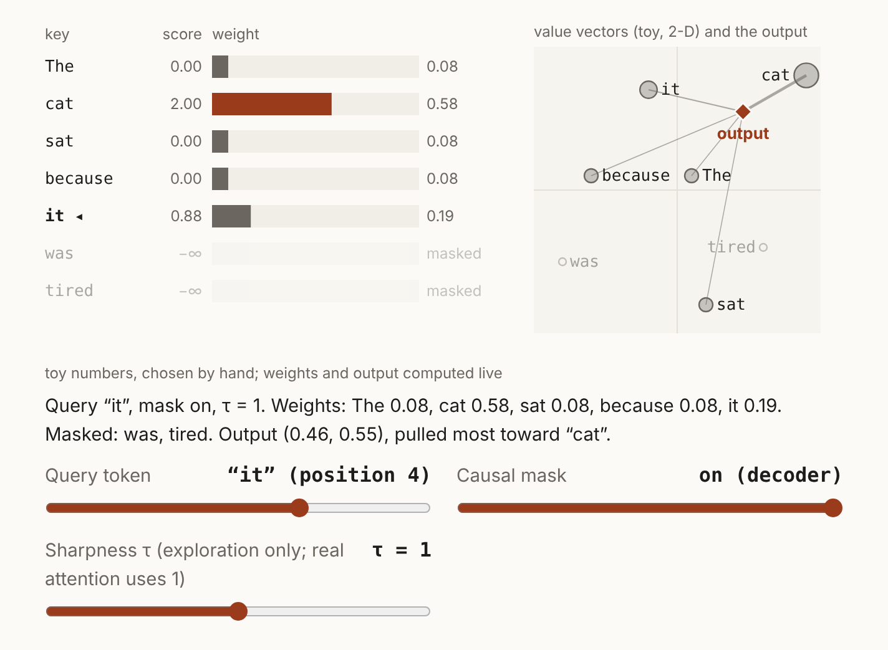
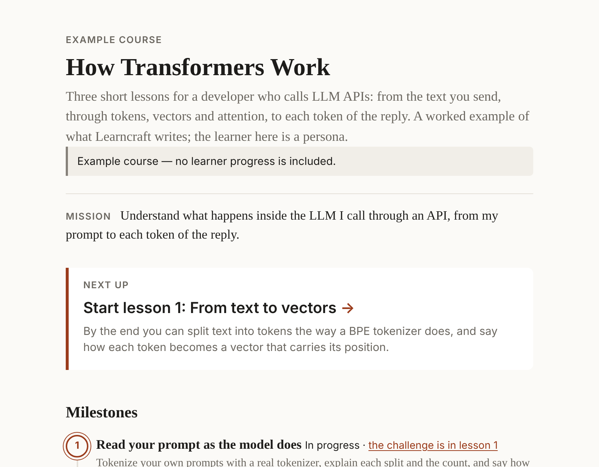
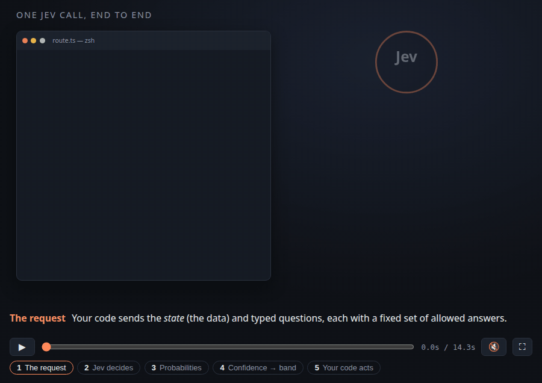

# Learncraft

**Turn your AI coding agent into a personal learning environment.**

Learncraft is a set of open agent skills (`SKILL.md`) for Claude Code and other agents that load the format. Ask it how something works and it teaches from first principles, then checks what you understood. Ask to learn a topic and it builds a course in your current folder: a mission, short lessons with diagrams and motion scenes, practice, spaced review and challenges. A milestone counts as mastered only after the agent has reviewed your own work.

```
/plugin marketplace add jpmmatias/skills
/plugin install learn@jpmmatias
```

That is inside Claude Code. For other agents, or without the plugin system: `npx skills add jpmmatias/skills --skill learn -g` (Node 22.20+).

<p>


</p>

<sub>From the shipped <a href="examples/transformers/index.html">example course</a>. Hand-authored to the skill's contracts, with no learner data.</sub>

**How is this different from just asking an AI?** A chat answer stays in the chat log and rarely checks what you took from it. Learncraft ends every explanation with questions to answer from memory, keeps the course as files you can reopen in a year, logs your first tries without overwriting them, schedules reviews from your results, cites sources with a verified/unverified status, and won't call anything "mastered" without evidence from your own work.

## Why it exists

AI agents explain well, but an explanation is not teaching: it reads fluently, you feel you understood, and nothing tests whether you did. Teachers rely on other things: retrieving from memory, spacing that retrieval out, worked examples that fade, and feedback on real attempts. Learncraft makes an agent do those things by default, and leaves you with a course you own instead of a chat log.

## What it does

| Mode | You say | You get |
|---|---|---|
| **Quick Learn** | "how does X work?" | an answer in chat: the problem it solves, one mental model, an ASCII diagram, a small example, 2–3 fetched links, and 2–3 questions to answer from memory. No files |
| **Deep Learn** | "teach me X properly" | one lesson in one sitting, as a page you can open from disk: a pretest, explanation, worked and faded examples, practice and a challenge |
| **Course** | `/learn <topic>` | a short interview (why, what you know, your setup), a diagnostic, a milestone plan, then one lesson per session |
| **Practice** | "quiz me" | fresh retrieval items in chat on objectives you have met, weakest first, interleaved |
| **Review** | "what's due?" | `review.html` runs a cold, mixed session over due objectives; the agent reads your exported progress and runs cold checks on mastered milestones |
| Repository Learning (**experimental**, not evaluated) | "teach me this codebase" | a course about a local repository, kept outside it, read-only, never sending its code anywhere |

Every lesson can include step-through diagrams, explorables and **narrated, scrubbable motion scenes**, built only when the motion is the concept:



<sub>A motion scene from an earlier course (pre-2.0 styling). In a lesson it is narrated, scrubbable and split into chapters, and it respects reduced-motion settings.</sub>

## Install

**Claude Code plugin** (the command becomes `/learn:learn`):

```
/plugin marketplace add jpmmatias/skills
/plugin install learn@jpmmatias
```

**skills.sh** (Claude Code and other agents; the command is `/learn`):

```bash
npx skills add jpmmatias/skills --skill learn -g -a claude-code
```

Then start a new session. Pipeline plugins (`curriculum-planner`, `source-researcher`, `lesson-panel`, `challenge-reviewer`), manual and symlink installs, the optional lesson-check tools and where each method puts the files: [docs/guides/installing.md](docs/guides/installing.md). Updating, and upgrading courses made with 1.x: [docs/guides/upgrading.md](docs/guides/upgrading.md).

## Your first learning session

1. Make an empty folder and open your agent in it.
2. Run `/learn <topic>` (`/learn:learn <topic>` as a plugin). Answer up to four questions: why you're learning, what you already know, your setup, and the language if unclear.
3. Answer the few diagnostic questions without looking anything up. "I don't know" is a useful answer.
4. Open `index.html`. It tells you what is **Next up**. Take the lesson: answer the practice from memory, then do the challenge.
5. Send the challenge work back in the same folder. The agent grades it against the written pass criteria; the milestone unlocks only if every criterion is met.
6. Come back any time and run `/learn` again. Open `review.html` when the dashboard says reviews are due.

Step by step, with screenshots and a path for non-technical learners: [docs/GUIDE.md](docs/GUIDE.md).

## Example courses

Three complete example courses, each with three lessons, practice files, a reference page and sources:

| Course | In the repo |
|---|---|
| How Transformers Work | [examples/transformers/](examples/transformers/index.html) |
| React Rendering Internals | [examples/react-rendering/](examples/react-rendering/index.html) |
| Probability & Statistics, by experiment | [examples/probability/](examples/probability/index.html) |

Open [`examples/index.html`](examples/index.html) from a clone, or the hosted gallery at **https://jpmmatias.github.io/skills/** (live once GitHub Pages is enabled for the repository). They were written by hand to the skill's lesson contract to show the output format; they are not transcripts of a model run, and they contain no learner progress. How they were made: [examples/README.md](examples/README.md).

## How it works

`learn/SKILL.md` is a short router. It picks the mode from what you ask, then loads only that mode's workflow and the references it names, so a one-off question doesn't load the course machinery.

A course lesson goes through a pipeline, each step writing files the next one reads:

```
plan-course ──► research-sources ──► write-lesson ──► review-panel ──► you ──► review-challenge
course.js       RESOURCES.md         lessons/*.html   .review/l<N>/          learning-records/
milestones,     ids, trust tiers,    + practice data  expert + novice        milestone status
objectives      verified/unverified  + scenes         verdicts, ≤ 2 rounds   in course.js
```

Each step is also a standalone plugin (`curriculum-planner`, `source-researcher`, `lesson-panel`, `challenge-reviewer`) that depends on `learn`.

**Profiles** trade cost for independent review. Pick with `--fast` or `--deep`, or set `profile:` in `NOTES.md`. Learncraft never upgrades to Deep on its own.

| | Fast | **Balanced** (default) | Deep |
|---|---|---|---|
| Review of each lesson | a self-checklist, marked not independent | expert + novice subagents, ≤ 2 rounds | expert + novice + course-flow subagents, ≤ 3 rounds |
| Source fetches per lesson | ≤ 4 | ≤ 8 | ≤ 15 |
| Agent calls per lesson (max) | 1 | 6 | 14 |
| Tokens per lesson | 30–45k | 70–100k | 200–350k |

Token figures are **design estimates, not measurements** ([profiles.md](skills/learn/references/profiles.md)). Without subagent support, Balanced and Deep run as Fast and tell you the review was not independent.

**Built on learning research**, with the strength the sources claim: retrieval practice, spacing and interleaving; faded worked examples; Mayer's multimedia principles for figures; animation only when the motion is the content (Höffler & Leutner, 2007); no "learning styles" matching, which lacks an adequate evidence base (Pashler et al., 2008); and light gamification, whose effect on learning the meta-analysis authors call small (Sailer & Homner, 2020). These citations are listed in [grounding.md](skills/learn/references/grounding.md) with their verification status; none could be fetched first-hand during the last review.

## Supported agents

| Agent | Status |
|---|---|
| Claude Code (plugin or skills folder) | install, loading, dependencies and review subagents **verified by us** |
| Codex CLI, Cursor, GitHub Copilot, Gemini CLI, OpenCode | files land where each vendor's docs say skills are read (**verified placement**); running Learncraft in them is **not verified** |
| claude.ai uploads / Skills API | **not supported as-is**: the `argument-hint` frontmatter key is rejected there |

Sources, dates, and which features need what (subagents, web access, Playwright, a browser): [docs/compatibility.md](docs/compatibility.md).

## Local-first

| What | Where | Who writes it |
|---|---|---|
| Mission, plan, lessons, sources, learning records, notes | files in your course folder | the agent |
| Milestone status | `assets/course.js` in that folder | the agent, only after a challenge review |
| Practice history and review schedule | your browser's `localStorage`, versioned, append-only | the course pages |
| Exported practice (`progress-<course>-<date>.json`) | wherever you save it; put it in `progress/` for the agent to read | you |

- Courses are static HTML, CSS and classic scripts. They open from disk, need no server, account or build step, and their Content-Security-Policy blocks network requests and remote scripts.
- Nothing leaves your machine because of Learncraft. Your agent's own model traffic and the web fetches it makes for sources are the agent's, as in any session.
- **Export / Import progress** on the dashboard moves your history between browsers and lets the agent see it. Practice is per browser until you export it; files in the folder are never affected.
- Upgrading from 1.x migrates browser progress automatically and leaves the old data untouched ([upgrading.md](docs/guides/upgrading.md#progress-data-migrates-automatically)).
- Data formats and schemas: [docs/architecture/data-model.md](docs/architecture/data-model.md).

## Evaluation and quality

What exists today, and what it does not prove:

- **`node scripts/validate.mjs`** (no install): skill frontmatter, the plugin manifest, native subagents in sync with their role files, every relative link and anchor in the Markdown, JSON Schemas and their examples, no hardcoded install paths, template asset references, JS syntax, and a lint of every example course.
- **`node --test tests/*.test.mjs`**: the validator, the workspace linter, the schemas, the progress store (migration, append-only history, review scheduling, import/export), and, when Playwright is installed, browser smoke and security tests (escaping, CSP, blocked storage).
- **Lesson check** (`check.mjs`): what the agent runs before handing over a lesson. Chromium in light, dark, phone and reduced-motion passes; JS errors, missing files, remote requests, overflow, unlabelled inputs, an axe-core scan; screenshots it then reads.
- **[evaluations/](evaluations/)**: rubrics for curriculum, lessons and assessment, and grounding; a deterministic workspace scorer; an instruction-cost meter (for example, the always-loaded `learn` instructions went from about 8.6k to 1.8k tokens, bytes/4 estimate). A protocol for live comparisons between profiles is written but **has not been run**, so there are no quality scores for generated courses yet.

CI runs the validator and tests on Node 20 and 22, the browser tests and example checks on Node 22.

## Roadmap

- Run the live comparison protocol (single agent vs pipeline vs profiles) and publish the results, whatever they are.
- Verify Learncraft in Codex, Cursor, Copilot, Gemini CLI and OpenCode, and move rows in the compatibility matrix only on evidence.
- Firefox and Safari checks of the course runtime on `file://`.
- Let chat practice and cold checks reach the browser's review schedule (today only exports flow from browser to agent).
- Evaluate Repository Learning before calling it more than experimental.
- Tagged releases with upgrade notes.

## Contributing

Issues and pull requests are welcome. [CONTRIBUTING.md](CONTRIBUTING.md) explains the ground rules (no runtime dependencies, no unverified claims), the checks to run, and who owns what. Security reports: [SECURITY.md](SECURITY.md). Brand and writing guidelines: [docs/brand/brand-guidelines.md](docs/brand/brand-guidelines.md).

## License

[MIT](LICENSE). Copyright (c) 2026 João Pedro Matias. Learncraft grew out of Matt Pocock's original ["teach" skill](https://github.com/mattpocock/skills), Copyright (c) 2026 Matt Pocock, also under MIT.
