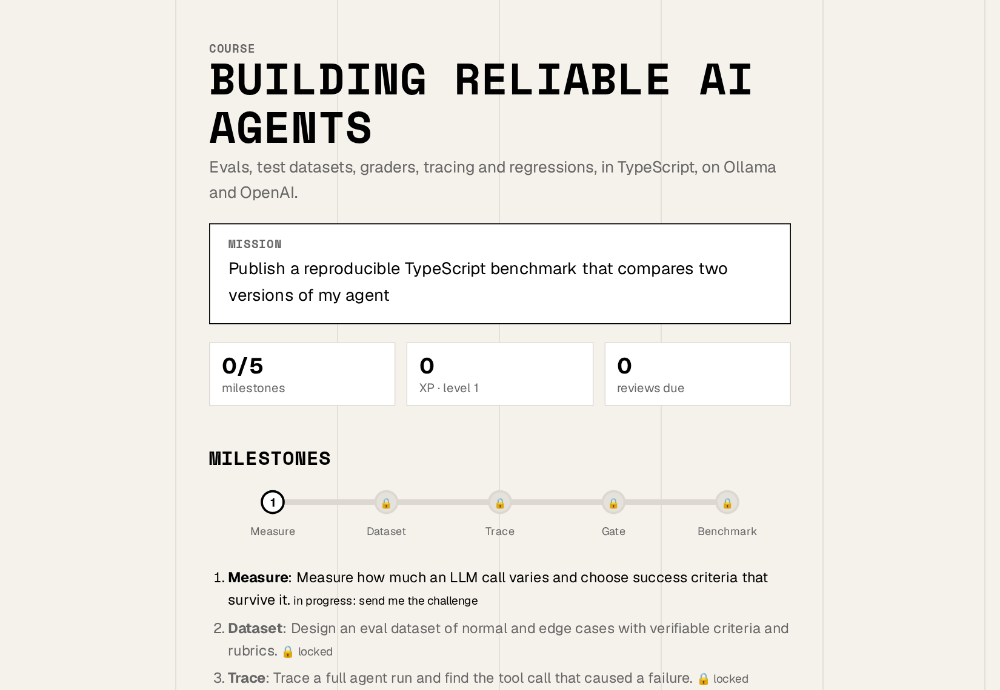
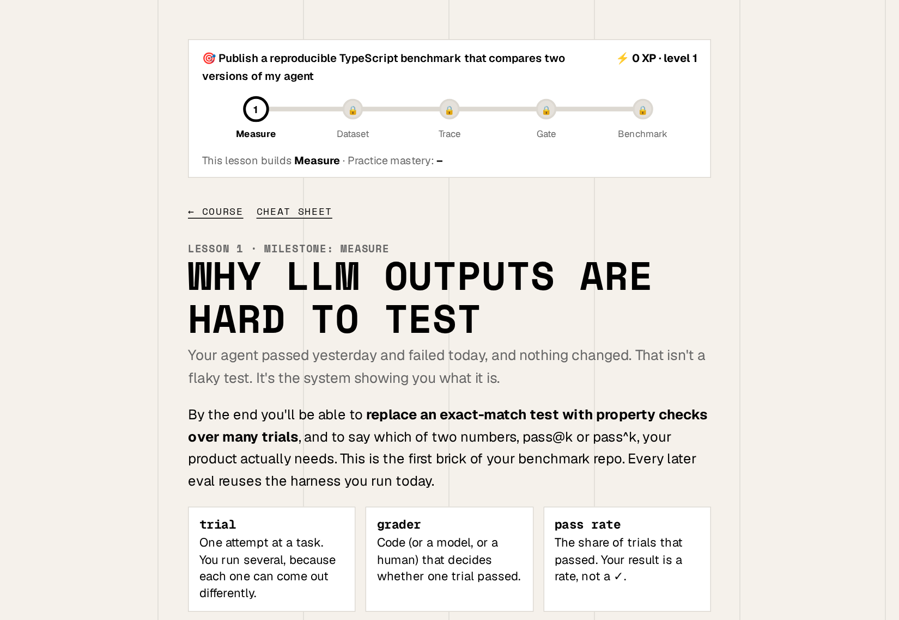
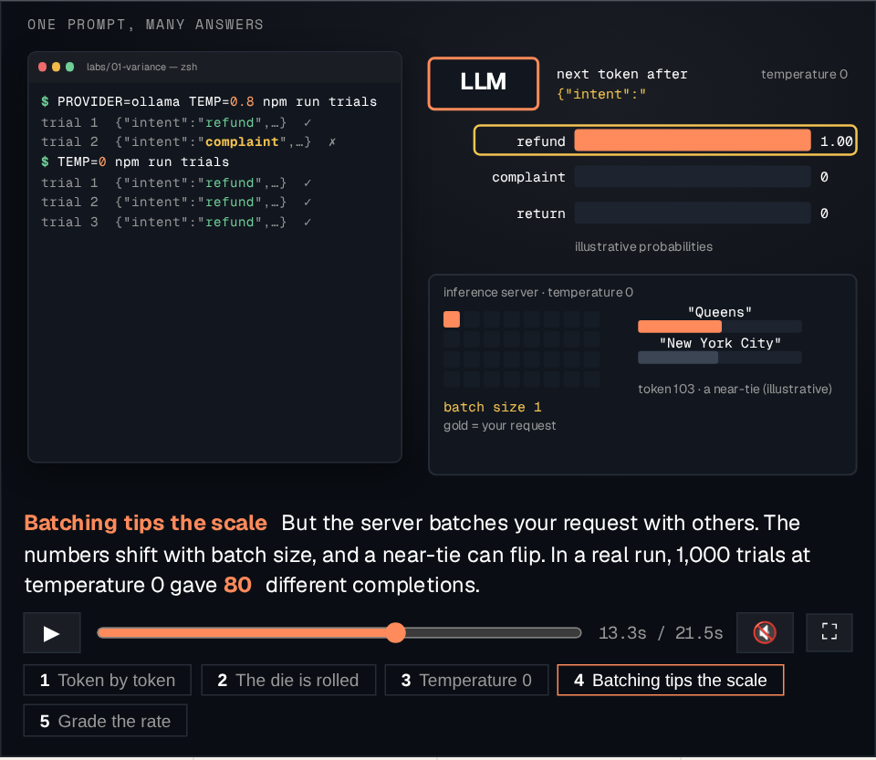
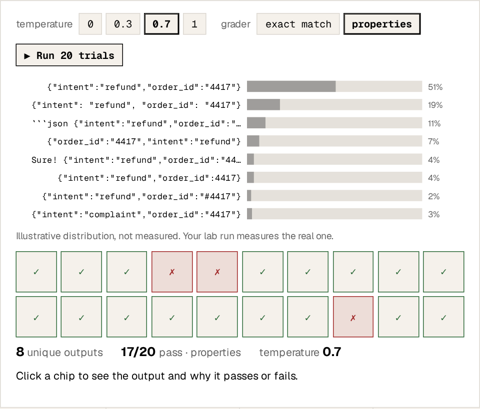
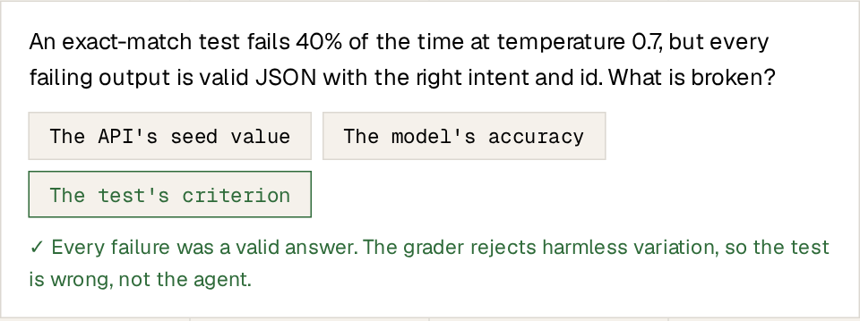
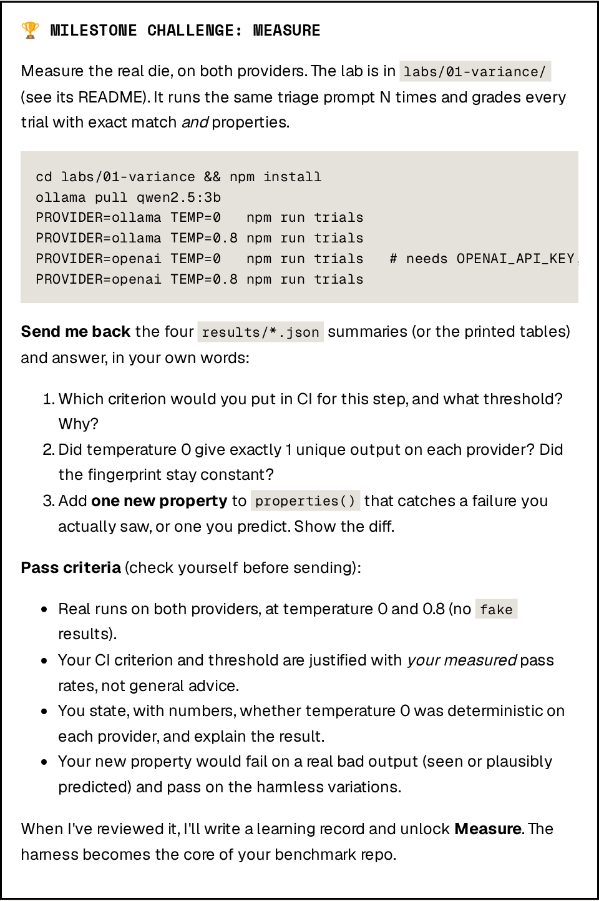
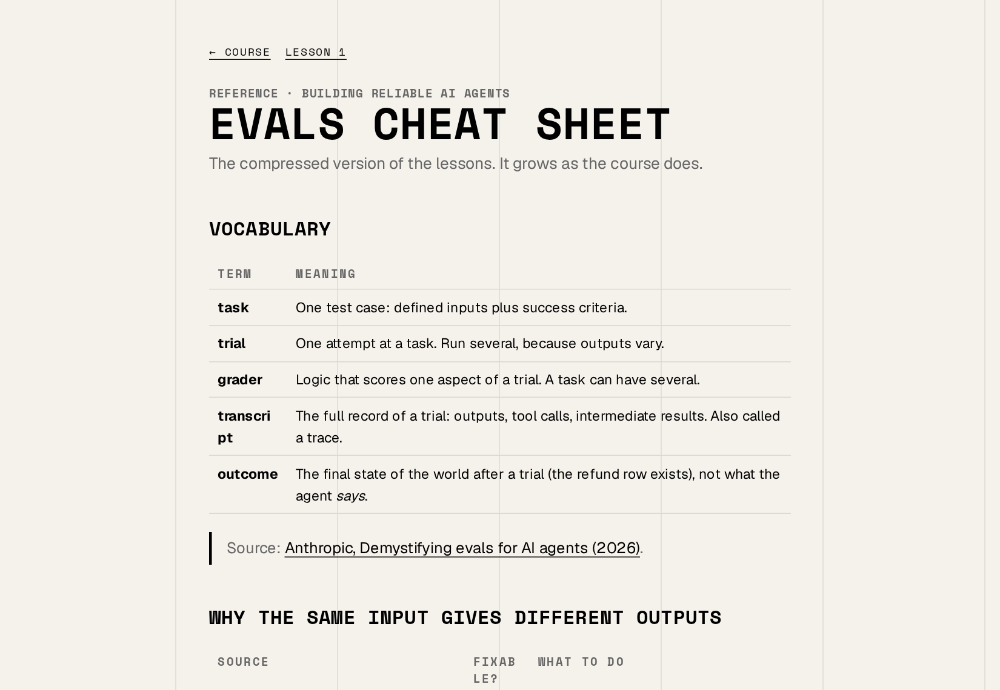
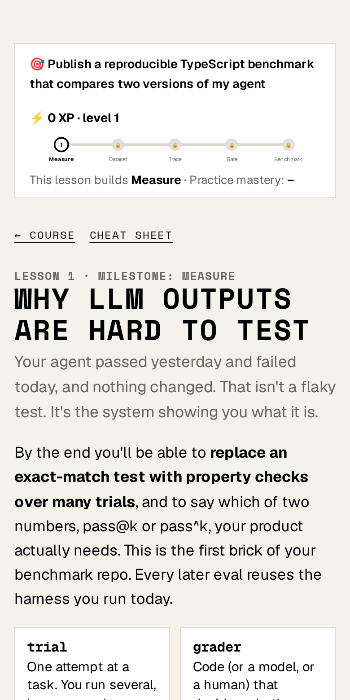

# How to use `learn`

`learn` turns Claude into a personal teacher. Tell it what you want to learn and why, and it builds a short course for you. The course is a set of web pages with lessons, diagrams, small animations, quizzes and real-world challenges. Claude reviews your work, remembers what you've shown you can do, and picks the next lesson from there.

The screenshots in this guide come from a real course made with the skill, *Building Reliable AI Agents*.

**Choose your path:**

- [**Part 1: For everyone**](#part-1-for-everyone-no-coding-needed). No coding needed. Takes about 10 minutes.
- [**Part 2: For technical users**](#part-2-for-technical-users). Install options, labs, customisation and how the workspace works.
- [**FAQ and troubleshooting**](#faq-and-troubleshooting)

---

## Part 1: For everyone (no coding needed)

### Step 1. Get Claude Code and the skill

You need [Claude Code](https://claude.com/claude-code) with a Claude plan. The **desktop app** (Mac and Windows) is the easiest way in if you don't use a terminal.

The easiest way to install the skill is to ask Claude to do it. Open Claude Code and paste:

> Please install the learn skill from github.com/jpmmatias/skills for me.

Claude runs the install command and asks you to approve it. When it's done, **start a new session** so Claude picks up the skill.

### Step 2. Make a folder for your course

Each course lives in its own folder, which keeps your lessons, progress and notes together. Create an empty folder, for example `Documents/learn-photography`, and open it in Claude Code.

### Step 3. Ask to learn something

Type `/learn` followed by your topic. Anything works, technical or not:

```
/learn film photography
/learn personal finance for freelancers
/learn how vaccines train the immune system
/learn beginner yoga for back pain
```

### Step 4. Answer a few questions

Before teaching anything, Claude asks up to four short questions. Your answers shape the whole course, so be honest and specific. A typical exchange:

```
Claude: Why do you want to learn this?
You:    I inherited my dad's Pentax and want to shoot a roll I'm proud of.

Claude: What do you know already?
You:    I use my phone camera a lot. I don't know what aperture means.

Claude: What do you have to practise with?
You:    The Pentax, two rolls of Portra 400, and weekends.

Claude: You wrote in Portuguese. Should the course be in Portuguese or English?
You:    Portuguese.
```

Claude then writes your **mission**, the reason behind the course, and builds the first lesson. Every lesson ties back to that mission.

### Step 5. Open your course

Claude opens the course in your browser. If it doesn't, open the file `index.html` in your course folder (double-click it). This is your **dashboard**:



- **Mission**: what you're working towards.
- **Milestones**: the big steps to get there. Each one unlocks only after Claude has reviewed real work from you. Clicking through lessons doesn't unlock them.
- **Reviews due**: lessons worth revisiting today. Spaced review is how things stick.

### Step 6. Take a lesson

Lessons are short: one idea and one win. Each one opens with a header that shows where you are on your path:



Inside a lesson you'll find a few kinds of pieces:

**Motion scenes.** When something happens over time, the lesson includes a short narrated animation, like an explainer video. You can play it, pause it, drag the timeline or jump between chapters. The speaker icon turns narration on.



**Interactive labs.** Change a setting and see what happens. You learn more by poking at it than by reading about it.



**Quizzes.** Answer from memory. A wrong answer tells you to try again, and a right one explains *why* it's right. You earn XP only for answers you get right on the first try, because that's what predicts you'll remember it.



Lessons also include worked examples, fill-in-the-blank exercises and a **Go deeper** list of hand-picked videos and articles.

### Step 7. Do the challenge and send it back

Every lesson ends with a **milestone challenge**: a real task that uses what you just learned. It says exactly what to send back and how it will be judged:



Do the task, then go back to Claude Code in the same folder and send your work: text, a photo, a file or a link. For example:

```
Here's my challenge for lesson 1. I shot the roll and attached three photos.
For the exposure question: I used f/8 in sun and f/2.8 indoors because...
```

Claude checks your work against each pass criterion:

- **If it passes**, the milestone unlocks on your dashboard and Claude records what you've shown you can do.
- **If it doesn't pass yet**, Claude tells you the smallest thing to fix. Nothing is lost.

### Step 8. Come back any time

Open Claude Code in the same folder and type `/learn` again. Claude reads your mission and your progress and continues from there. On the dashboard, **reviews due** shows which lessons to revisit.

Each course also builds a **cheat sheet** that you can keep open or print:



### Tips

- **Ask anything, any time.** "I didn't get the part about aperture." "Give me another example." "This is too easy." Claude is your teacher, so tell it what you need.
- **Say how it's going.** "Too long", "more pictures", "less maths". Claude remembers your preferences for the rest of the course.
- **Change the look.** Ask "make my course look like my website" and give the link.
- **Lessons work on your phone** and print cleanly on paper.



---

## Part 2: For technical users

### Install

Pick one method. The [README](../README.md#install) has the details.

| Method | Command | Best for |
|---|---|---|
| skills.sh | `npx skills add jpmmatias/skills --skill learn -g -a claude-code` | Most people. Also installs to other agents. |
| Claude Code plugin | `/plugin marketplace add jpmmatias/skills`, then `/plugin install learn@jpmmatias` | Updates through `/plugin`. Invoked as `/learn:learn`. |
| Manual copy | `cp -r skills/skills/learn ~/.claude/skills/learn` | No tooling. |
| Symlink | `ln -s ~/code/skills/skills/learn ~/.claude/skills/learn` | Editing the skill itself. |

### Two modes

- **Explain mode.** Outside a course folder, ask "how does TCP's congestion control actually work?". You get first principles, an ASCII diagram, a minimal annotated example and verified links, all in the terminal, with no files created.
- **Course mode.** Run `/learn <topic>` in a folder, or run `/learn` in a folder that already has a `MISSION.md`. The folder becomes a course that spans several sessions.

### What's in a course folder

```
index.html            dashboard (mission, milestones, mastery, reviews due)
MISSION.md            why you're learning; success criteria become milestones
lessons/0001-*.html   one self-contained lesson per file
lessons/scenes-*.js   motion scenes used by a lesson
reference/*.html      cheat sheets that grow with the course
labs/01-*/            runnable projects for hands-on topics
learning-records/     what you've proven, written after each challenge review
GLOSSARY.md           terms you've used correctly (added once earned, never in advance)
RESOURCES.md          vetted sources with type and length
NOTES.md              Claude's notes on your preferences, environment and decisions
assets/               shared CSS/JS components, theme.css, course.js manifest
```

Everything is plain HTML, CSS and JS. It opens from disk with no build step and no server. Progress (XP, mastery, review dates) is stored in your browser's `localStorage`. Milestone status comes from `assets/course.js`, which only Claude updates, after it reviews your evidence.

You can put the folder under git. Lessons are static files, so the course also publishes as-is on GitHub Pages or any static host.

### Labs (hands-on topics)

For programming and tooling topics, challenges come with a runnable lab in `labs/NN-name/`:

- **One command to run.** The lab's README covers setup.
- **A free or offline mode**, so you can start without a paid service. Synthetic output is clearly labelled and never counts as evidence.
- **Results files.** The lab writes a results file, and that file is what you send back for review.
- **It accumulates.** Lab code grows towards the mission, so by the end it's your project, not throwaway snippets.

At the start of a course, Claude checks your machine (runtimes, CLIs, API keys) with real commands and writes down what it found, so labs match what you actually have.

### Steering the course

You can say any of these in plain language, and Claude saves them to `NOTES.md` so they carry across sessions:

- "Teach in Portuguese, keep code in English."
- "More motion scenes" or "fewer animations, more exercises".
- "Make lessons shorter."
- "Skip ahead, I already know X." Claude may ask for a quick check first.
- "Change my mission to…" Claude confirms, updates `MISSION.md` and writes a learning record.

**Themes.** Every page links `assets/theme.css`. To use the same look for all new courses, save a theme as `~/.config/learn/theme.css`. To build a theme from a site, ask Claude, or follow [THEME-FORMAT.md](../skills/learn/THEME-FORMAT.md).

### Checking a course

The skill includes a headless check that Claude runs before handing over a lesson. You can run it yourself:

```bash
npm install --prefix ~/.claude/skills/learn/starter/tools     # once
node ~/.claude/skills/learn/starter/tools/check.mjs path/to/course [--only=0002]
```

It loads every page at desktop and phone width and reports JS errors, broken asset links, sideways scrolling and missing practice, challenges or scenes. It also saves screenshots of every figure and scene to `.check/`.

### Extending the skill

- `skills/learn/SKILL.md` holds the teaching rules: lesson design, evidence-based visuals, gamification, milestones and review.
- `skills/learn/starter/assets/` holds the components copied into every course. Each file's header documents its API. If you improve a component in a course, copy it back here.
- `skills/learn/starter/examples/scenes-0001-sampling.js` is a complete motion scene to copy from.
- The `*-FORMAT.md` files define the formats for mission, resources, learning records, glossary and themes.

Issues and pull requests are welcome at [github.com/jpmmatias/skills](https://github.com/jpmmatias/skills).

---

## FAQ and troubleshooting

**`/learn` isn't recognised.**
Start a new Claude Code session after installing. Check that `~/.claude/skills/learn/SKILL.md` exists. If you used the plugin, the command is `/learn:learn`.

**I see two `learn` skills.**
You installed it twice, for example as a plugin and as a copy. Remove one of them.

**My progress disappeared.**
XP and mastery live in the browser you used. A different browser, a private window or cleared site data starts from zero. Your milestones and learning records are files in the folder, so they're never lost.

**The lesson looks unstyled or broken.**
Open it from inside the course folder, so it can find `assets/`. Don't move a single lesson file somewhere else.

**Does it cost anything?**
The skill is free (MIT). It uses your Claude plan like any other Claude Code session. Labs in technical courses always have a free mode. Anything that uses a paid API says what it costs up front.

**Can I learn non-technical things?**
Yes. Skill-based topics (yoga, cooking, drawing) get practice-heavy lessons and real-world challenges. Knowledge topics (history, biology) get more diagrams, explanations and retrieval practice.

**Can I change the language?**
Yes. Say which language you want, or Claude asks when it can't tell. Code and the titles of sources stay in their original language.
