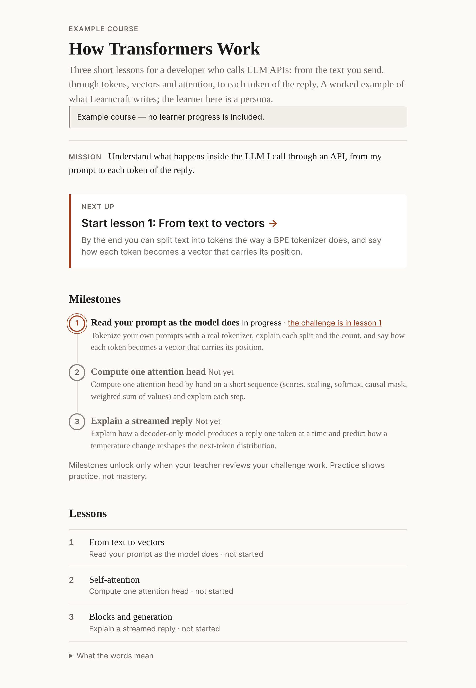
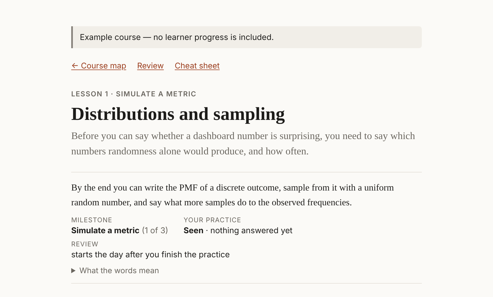
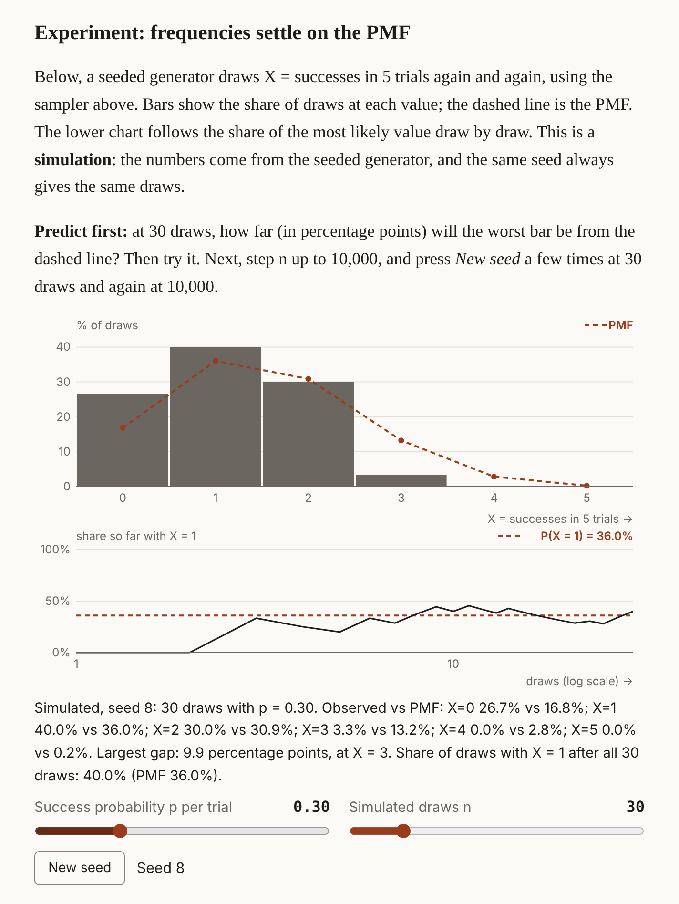
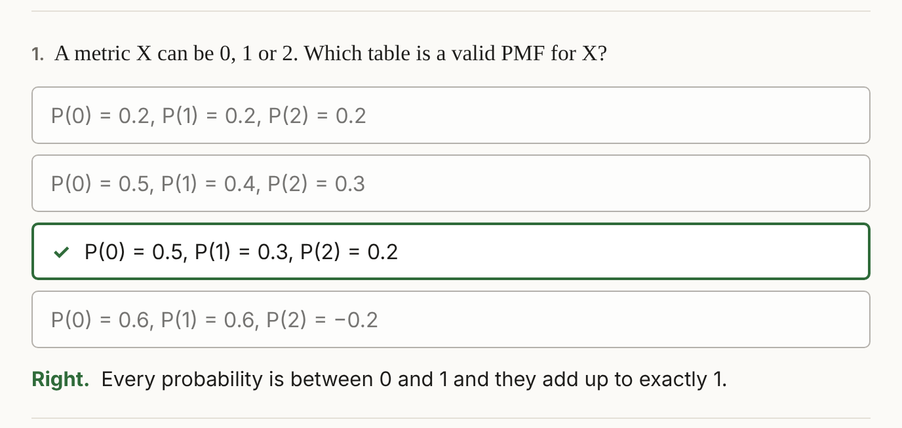
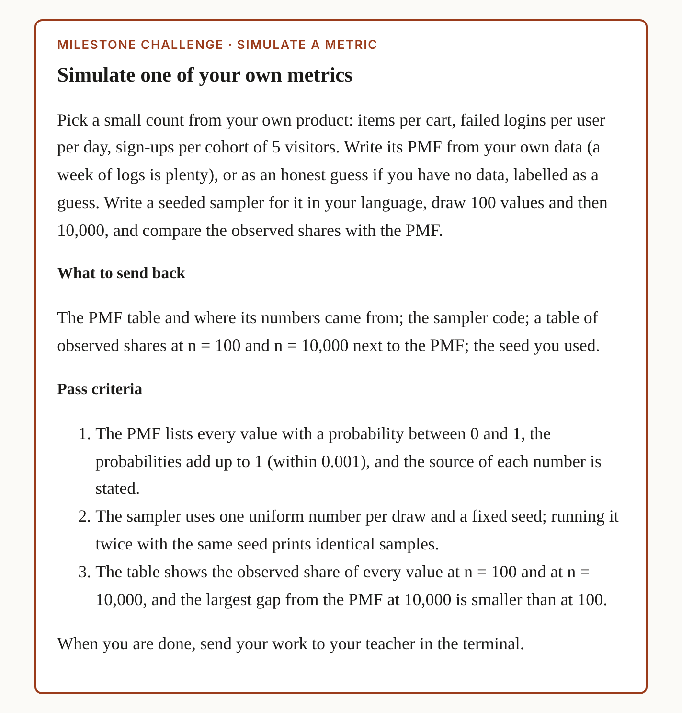
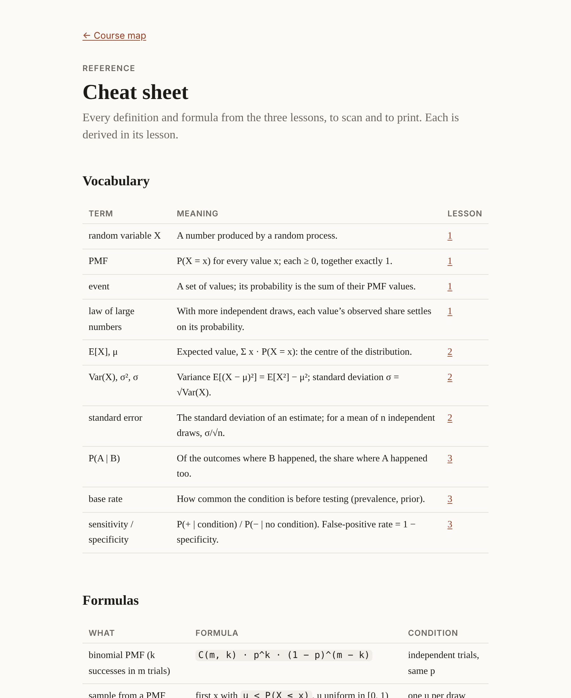
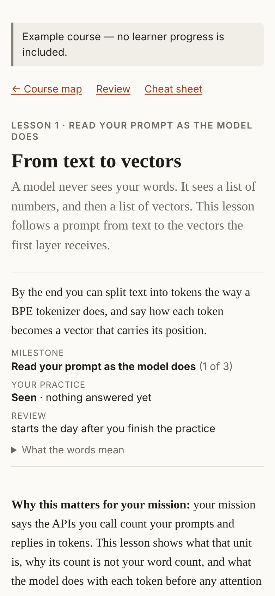

# How to use Learncraft

Learncraft turns your AI agent into a personal teacher. Tell it what you want to learn and why, and it builds a short course for you: a set of web pages with lessons, diagrams, small animations, practice questions and real-world challenges. It checks your work, keeps a record of what you have shown you can do, and picks the next lesson from there. The skill behind it is called `learn`.

The screenshots in this guide come from the [example courses](../examples/README.md) in this repository, unless a caption says otherwise.

**Choose your path:**

- [**Part 1: For everyone**](#part-1-for-everyone-no-coding-needed). No coding needed. Takes about 10 minutes.
- [**Part 2: For technical users**](#part-2-for-technical-users). Install options, modes, profiles, the course folder, labs, checks and customisation.
- [**FAQ and troubleshooting**](#faq-and-troubleshooting)

---

## Part 1: For everyone (no coding needed)

### Step 1. Get Claude Code and the skill

You need [Claude Code](https://claude.com/claude-code) with a Claude plan. The **desktop app** (Mac and Windows) is the easiest way in if you don't use a terminal. (Learncraft can also be installed for other agents; see [Part 2](#install).)

The easiest way to install it is to ask Claude. Open Claude Code and paste:

> Please install the learn plugin from the jpmmatias/skills marketplace on GitHub for me.

Claude runs the install and asks you to approve it. When it's done, **start a new session** so Claude picks it up. Installed this way, the command is `/learn:learn`; everywhere this guide says `/learn`, type `/learn:learn`.

### Step 2. Make a folder for your course

Each course lives in its own folder, which keeps your lessons, notes and records together. Create an empty folder, for example `Documents/learn-photography`, and open it in Claude Code.

### Step 3. Ask to learn something

Type `/learn` followed by your topic. Anything works, technical or not:

```
/learn film photography
/learn personal finance for freelancers
/learn how vaccines train the immune system
/learn beginner yoga for back pain
```

Just curious about one thing? Ask "how does X actually work?" instead. You get an explanation in the chat that ends with two or three questions to answer in your own words, and no course is created.

### Step 4. Answer a few questions

Before teaching anything, Claude asks up to four short questions. Your answers shape the whole course, so be honest and specific. A typical exchange:

```
Claude: Why do you want to learn this?
You:    I inherited my dad's Pentax and want to shoot a roll I'm proud of.

Claude: What have you done in this area so far?
You:    I use my phone camera a lot. I don't know what aperture means.

Claude: What do you have to practise with?
You:    The Pentax, two rolls of Portra 400, and weekends.

Claude: You wrote in Portuguese. Should the course be in Portuguese or English?
You:    Portuguese.
```

Then Claude asks a handful of quick questions to find where you really start. Answer without looking anything up. **"I don't know" is a good answer**: it saves you a lesson you don't need, and nothing is graded against you.

Claude then writes your **mission**, the reason behind the course, plans the milestones and builds the first lesson. Every lesson ties back to the mission.

### Step 5. Open your course

Claude opens the course in your browser. If it doesn't, open the file `index.html` in your course folder (double-click it). This is your **dashboard**:



- **Next up**: the one thing to do now: a review that is due, the next lesson, or a challenge to send back.
- **Milestones**: the big steps towards your mission. Each one unlocks only after Claude has reviewed real work from you. Clicking through lessons or answering practice questions doesn't unlock them.
- **Lessons**: each one with how far your practice has got, in words (Seen, Familiar, Understood…).
- **Your record**: your practice history lives in this browser. **Export progress** saves a copy; **Import progress** brings it into another browser.

### Step 6. Take a lesson

Lessons are short: one idea and one win. Under the title, a small panel shows what you will be able to do by the end, which milestone the lesson belongs to, and how your practice is going:



Inside a lesson you'll find a few kinds of pieces:

**Motion scenes.** When something happens over time, the lesson includes a short animation, like an explainer video. You can play it, pause it, drag the timeline or jump between chapters, and turn on narration where your browser supports it. A **Transcript** button shows the same content as text. If your device is set to reduce motion, scenes step through without animating.


**Interactive figures.** Change a value and see what happens. You learn more by poking at it than by reading about it.



**Check yourself.** Answer from memory before you scroll back. Every option explains *why* it is right or wrong. Your **first try** is what counts, and it is kept even if you reload the page and answer again, because that's what tells you (and Claude) what you actually remember. Some questions ask you to type the answer or put steps in order, which is harder than picking, and better practice.



Lessons also include worked examples, fill-in-the-blank exercises and a **Go deeper** list of sources. Small numbers next to a sentence link to the source behind it; a claim Claude could not check against a source is marked as not verified.

### Step 7. Do the challenge and send it back

Every lesson ends with a **challenge**: a real task that uses what you just learned. It says exactly what to send back and how it will be judged:



Do the task, then go back to Claude Code in the same folder and send your work: text, a photo, a file or a link. For example:

```
Here's my challenge for lesson 1. I shot the roll and attached three photos.
For the exposure question: I used f/8 in sun and f/2.8 indoors because...
```

Claude checks your work against each pass criterion:

- **If it passes**, the milestone unlocks on your dashboard and Claude writes down what you've shown you can do.
- **If it doesn't pass yet**, Claude tells you the smallest thing to fix. Nothing is lost.

### Step 8. Come back any time

Open Claude Code in the same folder and type `/learn` again. Claude reads your mission, its notes and your records, and continues from there.

When the dashboard says reviews are due, open **`review.html`** (in your course folder, in the same browser). It mixes short questions from earlier lessons without showing the lesson text. That is the point: pulling an answer out of memory a few days later is what makes it stick. Each topic comes back after 1, 3, 7, 14 and then 30 days if you keep getting it right, and sooner if you don't.

Want Claude to see how your practice is going? On the dashboard, click **Export progress**, move the downloaded file into a `progress` folder inside your course folder, and tell Claude. It reads the file and never changes it.

Each course also builds a **cheat sheet** that you can keep open or print:



### Tips

- **Ask anything, any time.** "I didn't get the part about aperture." "Give me another example." "This is too easy." Claude is your teacher, so tell it what you need.
- **Say "quiz me"** for a quick practice round in the chat, on things you've already learned.
- **Say how it's going.** "Too long", "more pictures", "less maths". Claude writes your preferences down for the rest of the course.
- **Change the look.** Ask "make my course look like my website" and give the link.
- **Lessons work on your phone** and print cleanly on paper.



---

## Part 2: For technical users

### Install

Pick one method. Full details, including the four optional pipeline plugins, where each method puts the files, and the lesson-check tools: [guides/installing.md](guides/installing.md).

| Method | Command | Notes |
|---|---|---|
| Claude Code plugin | `/plugin marketplace add jpmmatias/skills`, then `/plugin install learn@jpmmatias` | Invoked as `/learn:learn`. Ships the native review subagents `learn:lesson-*`. |
| skills.sh | `npx skills add jpmmatias/skills --skill learn -g -a claude-code` | Node 22.20+. `-a codex`, `-a cursor`, `-a github-copilot`, `-a gemini-cli`, `-a opencode` for other agents. Invoked as `/learn`. |
| Manual copy | `mkdir -p ~/.claude/skills && cp -R skills/skills/learn ~/.claude/skills/` | From a clone. No tooling. |
| Symlink | `mkdir -p ~/.claude/skills && ln -s ~/code/skills/skills/learn ~/.claude/skills/learn` | Editing the skill itself. |

Which agents are verified and which are only documented: [compatibility.md](compatibility.md). Updating, and upgrading a course made with 1.x: [guides/upgrading.md](guides/upgrading.md).

### Modes

The skill picks a mode from what you ask, not from which files happen to be in the folder. If two fit, it asks.

| Mode | Trigger | Writes |
|---|---|---|
| **Quick Learn** | a one-off "how does X work?", even inside a course folder | nothing; ends with retrieval questions it then grades |
| **Deep Learn** | "teach me X properly", one sitting | a one-lesson course (pretest, explanation, worked and faded example, ≥ 4 practice items, a challenge) that can grow into a full course |
| **Course** | `/learn <topic>` with no `MISSION.md`; `/learn` or "next lesson" with one | the workspace below, one lesson per session |
| **Practice** | "quiz me" | fresh items in chat, weakest objectives first; a line in `NOTES.md` |
| **Review** | "what's due?", or an exported progress file | points you at `review.html`, reads exports, runs cold checks of mastered milestones in chat |
| **Repository Learning** (experimental) | "teach me this codebase" | a course about a local repository, kept outside it; read-only on the repo; never sends its contents anywhere |

### Profiles

Each lesson is produced under a profile. Pass `--fast` or `--deep` with the command, or write `profile: fast|balanced|deep` in `NOTES.md`. The default is **Balanced**. Learncraft never upgrades to Deep on its own, and when a capability is missing it downgrades and tells you once.

| | Fast | Balanced (default) | Deep |
|---|---|---|---|
| Lesson review | the author's self-checklist, marked `independence: self` | separate expert and novice subagents, up to 2 rounds | expert, novice and course-flow subagents, up to 3 rounds; the author is a subagent too |
| Source fetches per lesson | ≤ 4 | ≤ 8 | ≤ 15 |
| Tokens per lesson (estimate, not measured) | 30–45k | 70–100k | 200–350k |

The full budget table is in [profiles.md](../skills/learn/references/profiles.md). If your agent cannot start subagents, Balanced and Deep run as Fast and the review is labelled as not independent.

### What's in a course folder

```
index.html              dashboard: Next up, milestones with evidence, lessons, export/import
review.html             cold review session over due objectives
MISSION.md              why you're learning; success criteria become milestones
NOTES.md                language, profile, theme, environment, per-lesson decisions, preferences
assets/course.js        course manifest (v2): milestones, lessons, objectives; milestone status
assets/*                the runtime copied from the skill, plus theme.css
lessons/0001-*.html     one lesson per file
lessons/0001.practice.js  that lesson's practice items, as data
lessons/scenes-0001.js  motion scenes used by a lesson
reference/*.html        cheat sheets that grow with the course
labs/01-*/              runnable projects for hands-on topics
RESOURCES.md            sources with ids, trust tiers and verified/unverified status
learning-records/       what you've shown: diagnostic, challenge reviews, cold checks, misconceptions
GLOSSARY.md             terms you've used correctly (added once earned, never in advance)
progress/*.json         practice history you exported from the browser (the agent only reads these)
.review/l<N>/           review-panel state and verdicts
.check/                 screenshots from the lesson check
```

Everything is plain HTML, CSS and classic scripts. It opens from disk with no build step, no server and no account, and every page carries a Content-Security-Policy that blocks network requests and remote scripts.

**Where state lives.** Files in the folder are the source of truth: the mission, the plan, the records and milestone status (which only Claude changes, after a challenge review). Browser practice is kept in your browser's `localStorage` as an append-only history: first tries are never overwritten, and levels and review dates are recomputed from it, never stored. Export it to share it with Claude or move it to another browser. Formats: [data-model.md](architecture/data-model.md).

You can put the folder under git. Lessons are static files, so the course also publishes as-is on GitHub Pages or any static host (that is how the [example gallery](../examples/index.html) is served).

### Mastery, in words

Practice and mastery are kept apart on purpose:

| Level | Comes from |
|---|---|
| Seen, Familiar, Understood | your browser practice (Understood is the most practice alone can reach) |
| Applied | a challenge Claude reviewed and passed |
| Retained | a cold review some days later |
| Transferred | applying it in a new context, judged in a challenge review |

The exact rules: [mastery.md](../skills/learn/references/mastery.md).

### Labs (hands-on topics)

For programming and tooling topics, challenges come with a runnable lab in `labs/NN-name/`:

- **One command to run.** The lab's README covers setup.
- **A free or offline mode**, so you can start without a paid service. Synthetic output is clearly labelled and never counts as evidence.
- **Results files.** The lab writes a results file, and that file is what you send back for review.
- **It accumulates.** Lab code grows towards the mission, so by the end it's your project, not throwaway snippets.

At the start of a course, Claude checks your machine (runtimes, CLIs, whether an API key is set, without printing it) with real commands and writes down what it found, so labs match what you actually have.

### Steering the course

You can say any of these in plain language, and Claude saves them to `NOTES.md` so they carry across sessions:

- "Teach in Portuguese, keep code in English."
- "More motion scenes" or "fewer animations, more exercises".
- "Make lessons shorter."
- "Use the fast profile from now on."
- "Skip ahead, I already know X." Claude may ask for a quick check first.
- "Change my mission to…" Claude confirms, updates `MISSION.md` and writes a learning record.

**Themes.** Every page links `assets/theme.css`. To use the same look for all new courses, save a theme as `~/.config/learn/theme.css`. To build a theme from a site, ask Claude, or follow [THEME-FORMAT.md](../skills/learn/THEME-FORMAT.md).

### Checking a course

Before handing over a lesson, Claude can run a headless check. The easiest way to run it yourself is to ask: "run the lesson check on this course". To run it by hand, install the tools once (they go in a folder that survives skill updates):

```bash
npm install --prefix ~/.cache/learncraft/tools playwright@1.63.0 axe-core@4.10.2
npx --prefix ~/.cache/learncraft/tools playwright install chromium
```

then, from the course folder, with `<skill>` being the `learn` skill's folder ([where it is](guides/installing.md#check-the-install)):

```bash
node "<skill>/starter/tools/check.mjs" . [--only=0002]
```

It lints the course data (manifest, practice files, citations, source statuses, learning records), then loads every page in Chromium at desktop and phone width, in light, dark and reduced-motion modes. It reports JS errors, missing files, any network request, sideways scrolling, unlabelled inputs, missing practice or challenges, and an axe-core accessibility scan, and saves screenshots of every figure and scene to `.check/`.

### Extending the skill

- `skills/learn/SKILL.md` is a short router. The steps live in `skills/learn/workflows/` and the principles and specs in `skills/learn/references/` ([components.md](../skills/learn/references/components.md) documents the runtime APIs).
- `skills/learn/starter/` holds the runtime (`assets/`), the page templates (`templates/`), worked examples (`examples/`) and the check tools (`tools/`).
- The `*-FORMAT.md` files define the mission, resources, learning-record, glossary and theme formats.
- The skill never writes into its own folder. If Claude improves a component in one of your courses, it notes the idea in `NOTES.md` under `## Upstream`; send it as an issue or a pull request instead of copying files into an installed skill.

How to test a change and what the checks do: [CONTRIBUTING.md](../CONTRIBUTING.md). Issues and pull requests are welcome at [github.com/jpmmatias/skills](https://github.com/jpmmatias/skills).

---

## FAQ and troubleshooting

**`/learn` isn't recognised.**
Start a new session after installing. As a plugin, the command is `/learn:learn`. In Claude Code, `/skills` lists installed skills and `claude plugin list` shows plugins. Where each install method puts the files: [installing.md](guides/installing.md#check-the-install).

**I see two `learn` skills.**
You installed it twice, for example as a plugin and as a copy. Remove one of them.

**My practice progress disappeared.**
Practice history lives in the browser you used. A different browser, a private window or cleared site data starts empty. Use **Export progress** regularly if that matters to you, and **Import progress** to bring it back. Your milestones and learning records are files in the folder, so they're never lost.

**The dashboard says storage is unavailable.**
Your browser is blocking local storage (often a private window). Practice still works on the page but is not kept. Open the course in a normal window.

**I made a course with an older version.**
It keeps working. To get the new dashboard, review page and export, follow [Upgrade an existing course](guides/upgrading.md#2-upgrade-an-existing-course-runtime-v1--v2). Your browser progress is migrated automatically and the old data is left untouched.

**The lesson looks unstyled or broken.**
Open it from inside the course folder, so it can find `assets/`. Don't move a single lesson file somewhere else.

**Does it cost anything?**
The skill is free (MIT). It uses your Claude plan like any other session. The profile changes how much a lesson uses: Fast is cheapest, Deep the most (see [Profiles](#profiles); the numbers are estimates). Labs in technical courses always have a free mode, and anything that uses a paid API says what it costs up front.

**Can I learn non-technical things?**
Yes. Skill-based topics (yoga, cooking, drawing) get practice-heavy lessons and real-world challenges. Knowledge topics (history, biology) get more diagrams, explanations and retrieval practice.

**Can I change the language?**
Yes. Say which language you want, or Claude asks when it can't tell. The page controls are translated for English and Portuguese; for other languages Claude can supply its own strings. Code and the titles of sources stay in their original language.
